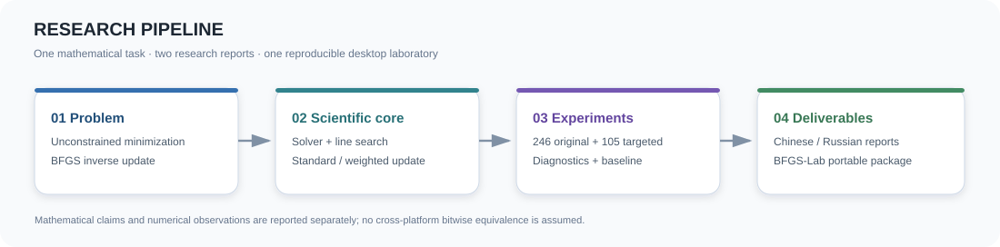
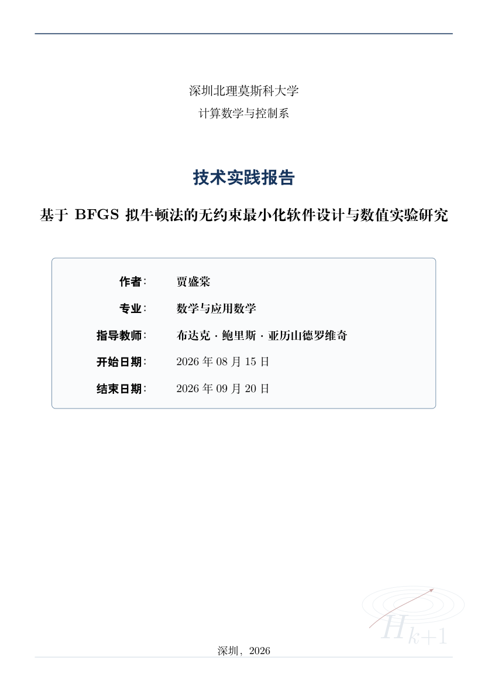
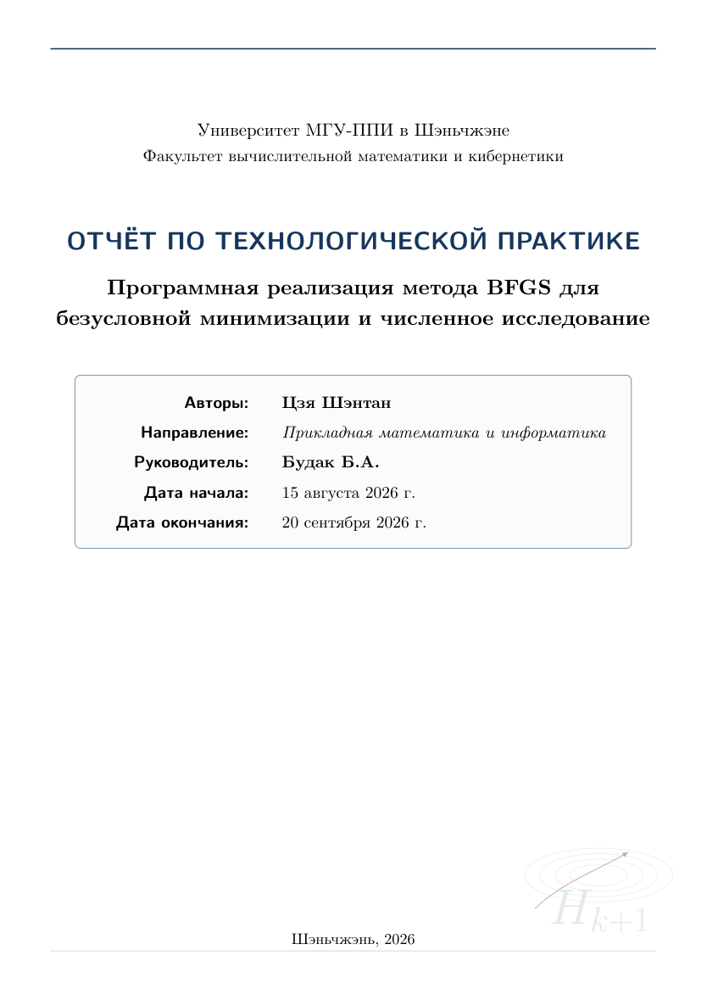
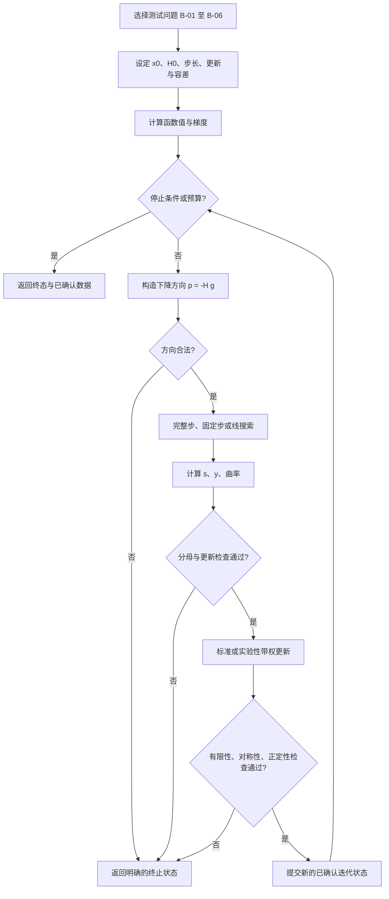
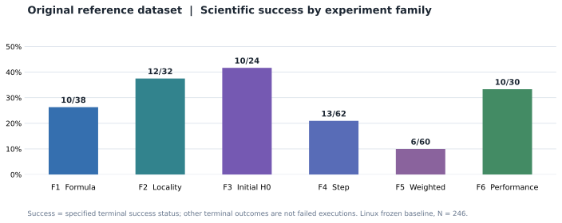
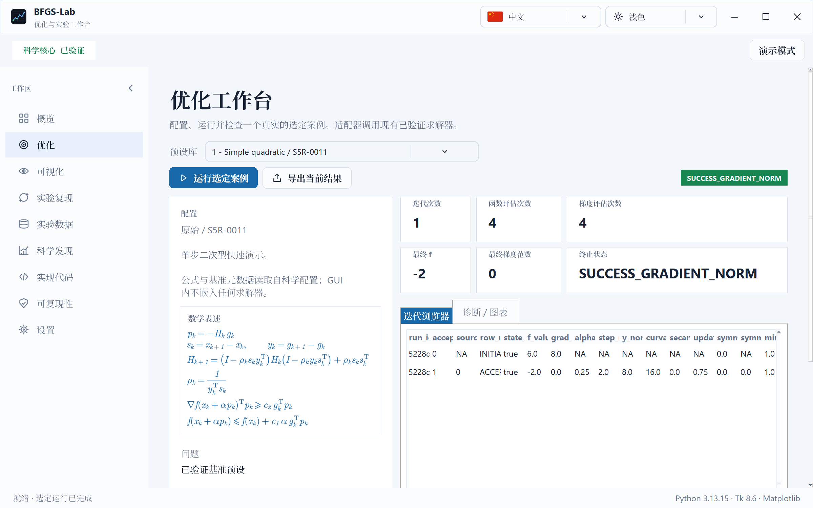
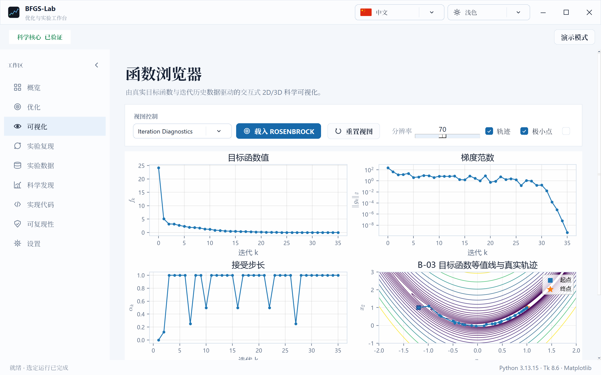
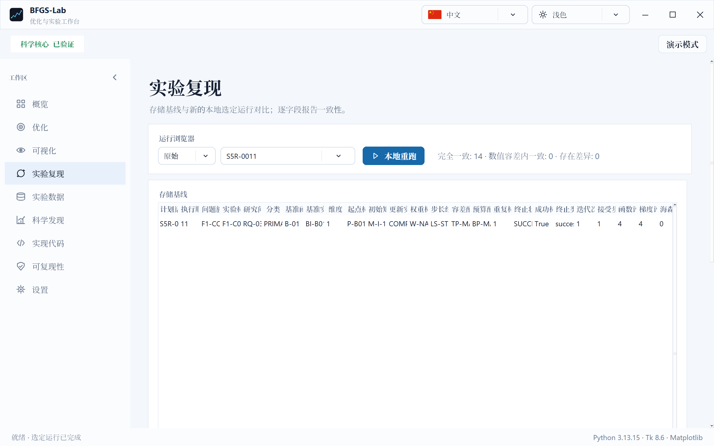
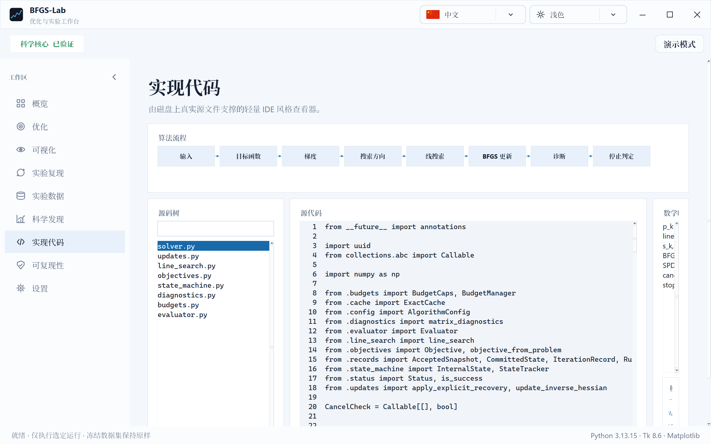
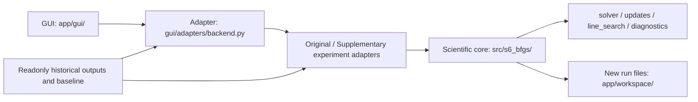

<div align="center">

<a id="top"></a>

# BFGS-Lab · 拟牛顿法与无约束最小化

**基于 BFGS 拟牛顿法的无约束最小化软件设计与数值实验研究**  
*Программная реализация метода BFGS для безусловной минимизации и численное исследование*

**技术实践 · 双语研究报告 · 可复现实验 · Windows 便携桌面软件**

<p>
  <a href="./papers/BFGS_zh.pdf"></a>
  <a href="./papers/BFGS_ru.pdf"></a>
  <a href="https://github.com/Bluevarpi/BFGS-Lab/releases/tag/v1.0.0"></a>
  <a href="#research"></a>
</p>

<p>
  
  
  
  
  
</p>

**[项目概览](#overview) · [原始任务](#assignment) · [数学方法](#mathematics) · [实验结果](#research) · [论文导读](#papers) · [软件展示](#software) · [下载导航](#downloads) · [运行与复现](#usage) · [LaTeX 编译](#latex) · [QA 与限制](#qa) · [GitHub 模块](#github)**

</div>

---

<div align="center">
  
</div>

<a id="overview"></a>
## 项目概览

本仓库展示深圳北理莫斯科大学（МГУ-ППИ）计算数学与控制系技术实践项目，围绕 **BFGS（Broyden–Fletcher–Goldfarb–Shanno）拟牛顿方法**，建立从问题定义、逆 Hessian 近似更新到数值实验和桌面可视化的软件研究流程. 仓库包含 **中文与俄文各一份 33 页研究报告、两套可独立编译的精简 LaTeX 源码**，以及在 GitHub Release 中分发的 **BFGS-Lab Windows x64 便携软件**. 

| 项目 | 内容 |
|:---|:---|
| 研究方向 | 数值优化、无约束最小化、拟牛顿法、科学软件与数值复现 |
| 原始选题 | Б. А. Будак，《Задания технологической практики》，第 1 题 BFGS（提供的任务集文件名含 2025；原页注明 © 2024） |
| 中文报告 | 《基于 BFGS 拟牛顿法的无约束最小化软件设计与数值实验研究》，33 页 |
| 俄文报告 | 《Программная реализация метода BFGS для безусловной минимизации и численное исследование》，33 页 |
| 作者 | 贾盛棠 / Цзя Шэнтан |
| 指导教师 | Будак Б. А.（布达克·鲍里斯·亚历山德罗维奇） |
| 报告时间 | 2026 年 8 月 15 日—9 月 20 日 |
| 实验范围 | 256 个原设计单元（10 个技术验证 + 246 个科学运行），另有 105 个补充科学运行 |
| 实现 | Python、NumPy、Tkinter/ttk、Matplotlib；科学核心与 GUI 适配层分离 |
| 研究性质 | 具体测试函数与固定配置上的数值研究；**并非一般 BFGS 性能或全局收敛保证** |

<div align="center">
<table>
<tr>
  <td align="center" width="50%"><a href="./papers/BFGS_zh.pdf"></a><br><strong>中文论文 · 33 页</strong><br><a href="./papers/BFGS_zh.pdf">阅读中文 PDF ↗</a></td>
  <td align="center" width="50%"><a href="./papers/BFGS_ru.pdf"></a><br><strong>Русский отчёт · 33 стр.</strong><br><a href="./papers/BFGS_ru.pdf">阅读俄文 PDF ↗</a></td>
</tr>
</table>
</div>

> <strong>范围与发布说明：</strong>本仓库是个人技术实践作品展示，并非学校或指导教师官方仓库. 教师原始十页选题集用于识别研究来源；其全文 **不随本仓库重新公开分发**. 以下原题介绍为依据选题集第 1 页撰写的中文释义，而不是声明教师材料获得开放许可. 

<a id="assignment"></a>
## 一、原始问题与完整任务描述

### 1.1 任务原文的数学内容

教师给出的第一题标题为 **«ЗАДАНИЕ ТЕХНОЛОГИЧЕСКОЙ ПРАКТИКИ (BFGS)»**. 要求开发一个利用 BFGS 拟牛顿方法求解无约束最小化问题的软件系统，即研究
$$\inf_{x\in\mathbb{R}^{n}}f(x).$$

按照题目所采用的符号，迭代方案为 $`\displaystyle x_{k+1}=x_k-\alpha_kH_kf'(x_k)`$，其中位移向量 $`\displaystyle z_k=x_{k+1}-x_k`$，梯度差 $`\displaystyle y_k=f'(x_{k+1})-f'(x_k)`$. 

原题的逆 Hessian 近似更新式可写成如下等价形式. 记残差向量 $`\displaystyle r_k=z_k-H_ky_k`$、曲率分母 $`\displaystyle \delta_k=z_k^{\mathrm T}y_k`$，则
$$H_{k+1}=H_k+\frac{r_kz_k^{\mathrm T}+z_kr_k^{\mathrm T}}{\delta_k}-\frac{y_k^{\mathrm T}r_k}{\delta_k^{2}}z_kz_k^{\mathrm T}.$$

其中，初始点 $`\displaystyle x_0`$ 与初始矩阵 $`\displaystyle H_0`$ <strong>由用户在程序启动时给定</strong>；题目将 $`\displaystyle \alpha_k=1`$ 作为常见的基准步长，要求在具有已知局部极小点的经典测试函数上检验算法.  $`\displaystyle H_k`$ 近似逆 Hessian 矩阵， $`\displaystyle z_k`$ 在研究报告中改记为 $`\displaystyle s_k`$，二者指同一位移向量. 

### 1.2 教师规定的四项研究任务

| 原始要求 | 本项目对应研究内容 | 论文定位 |
|:---|:---|:---|
| **局部收敛性** | 研究 $`\displaystyle x_0`$ 距已知极小点 $`\displaystyle x^{\ast}`$ 的远近、 $`\displaystyle H_0`$ 与 $`\displaystyle [\nabla^2f(x^{\ast})]^{-1}`$ 的接近程度，及不同方向、几何条件的影响 | 第 2.5、4.4、4.7 节；F2 / F3 / RQ-S1 / RQ-S2 |
| **收敛速度** | 给出可核查的数值轨迹与速度诊断，区分有限精度证据和渐近超线性收敛的数学定理 | 第 2.5、4.8 节；F6 |
| **修改更新矩阵** | 研究标准 BFGS 修正项的带权方案，以及割线条件和正定性是否依然保持 | 第 2.4、4.6 节；F5 / RQ-S6 |
| **步长允许范围** | 比较 $`\displaystyle \alpha_k=1`$、其他固定步长与 Armijo/Wolfe 等线搜索，不将局部数值区间外推为普适结论 | 第 2.3、4.5 节；F4 |

教师的原任务面向三人小组；本仓库发布的材料以**现存两份研究报告及软件的实际内容**为范围，不对未提供的团队分工作额外推断. 

<details>
<summary><strong>为什么原题中的四个问题必须分别回答？</strong></summary>

局部收敛是初值与问题局部几何的性质；收敛阶是误差序列在一定条件下的渐近性质；矩阵更新权重改变算法本身；步长和线搜索控制搜索方向上的接受机制. 它们在实验中会发生交互，不能用某一个成功率图同时证明四项性质. 报告用 F1–F6 和补充设计 RQ-S1–RQ-S6 分开观察，再分析变量交互. 

</details>

<a id="mathematics"></a>
## 二、BFGS 的数学模型与算法

### 2.1 从 Newton 方向到逆 Hessian 更新

设 $`\displaystyle g_k=\nabla f(x_k)`$， $`\displaystyle G_k=\nabla^2f(x_k)`$，并取对称矩阵 $`\displaystyle H_k\approx G_k^{-1}`$. 搜索方向为 $`\displaystyle p_k=-H_kg_k`$，新点为 $`\displaystyle x_{k+1}=x_k+\alpha_k p_k`$. 当 $`\displaystyle H_k\succ0`$ 且 $`\displaystyle g_k\ne0`$ 时， $`\displaystyle g_k^{\mathrm T}p_k=-g_k^{\mathrm T}H_kg_k<0`$，因此 $`\displaystyle p_k`$ 是下降方向. 

令 $`\displaystyle s_k=x_{k+1}-x_k`$， $`\displaystyle y_k=g_{k+1}-g_k`$， $`\displaystyle \rho_k=(s_k^{\mathrm T}y_k)^{-1}`$，并定义 $`\displaystyle V_k=I-\rho_ks_ky_k^{\mathrm T}`$. 标准逆 BFGS 的紧凑更新为
$$H_{k+1}=V_kH_kV_k^{\mathrm T}+\rho_ks_ks_k^{\mathrm T}.$$

设 $`\displaystyle r_k=s_k-H_ky_k`$、 $`\displaystyle \delta_k=s_k^{\mathrm T}y_k`$，则等价的展开更新是
$$H_{k+1}=H_k+\frac{r_ks_k^{\mathrm T}+s_kr_k^{\mathrm T}}{\delta_k}-\frac{y_k^{\mathrm T}r_k}{\delta_k^{2}}s_ks_k^{\mathrm T}.$$

在精确算术且分母非零时，上述更新满足**割线条件** $`\displaystyle H_{k+1}y_k=s_k`$. 若 $`\displaystyle H_k\succ0`$ 且 $`\displaystyle s_k^{\mathrm T}y_k>0`$，标准 BFGS 更新保持正定性. 采用下降方向和满足相应条件的 Wolfe 线搜索可以保证所需的正曲率；这并不意味着报告中所有实验都采用 Wolfe 搜索. 

### 2.2 带权修正为何是独立研究对象

令 $`\displaystyle r=s-Hy`$、 $`\displaystyle \delta=s^{\mathrm T}y\ne0`$. 报告研究如下实验性带权修正：
$$H_+^{(a,b)}=H+a\frac{rs^{\mathrm T}+sr^{\mathrm T}}{\delta}-b\frac{y^{\mathrm T}r}{\delta^{2}}ss^{\mathrm T}.$$

当 $`\displaystyle a=b=1`$ 时回到标准 BFGS. 一般权重下，其割线残差可写成
$$H_+^{(a,b)}y-s=(a-1)r+(a-b)\frac{y^{\mathrm T}r}{\delta}s.$$

因此，非标准权重**一般不保留**标准 BFGS 的割线条件和正定性保证. 软件中将其作为需要诊断的实验方案，而不是未经证明的等价 BFGS 方法. 

### 2.3 六类测试函数与已知最小点

程序中六类 benchmark 的数学对象由 `app/src/s6_bfgs/objectives.py` 定义；其目的不是用成功比例代替理论，而是利用已知极小点和解析梯度与 Hessian 核验更新算法. 

| 测试编号 | 数学类型 | 允许维数 | 已知极小点 |
|:---|:---|:---|:---|
| **B-01** | 正定三对角二次函数 | $`\displaystyle n\geqslant 1`$ | $`\displaystyle x^{\ast}=\mathbf{1}`$ |
| **B-02** | 可调整条件数的对角二次函数 | $`\displaystyle n\geqslant 1`$ | $`\displaystyle x^{\ast}=\mathbf{1}`$ |
| **B-03** | 二维 Rosenbrock 函数 | $`\displaystyle n=2`$ | $`\displaystyle x^{\ast}=(1,1)`$ |
| **B-04** | 二维 Himmelblau 函数 | $`\displaystyle n=2`$ | 四个已知局部极小点 |
| **B-05** | 分块 Rosenbrock 函数 | $`\displaystyle n`$ 为正偶数 | $`\displaystyle x^{\ast}=\mathbf{1}`$ |
| **B-06** | 分块 Powell singular 函数 | $`\displaystyle n`$ 为 4 的正整数倍 | $`\displaystyle x^{\ast}=\mathbf{0}`$ |

各函数的完整表达式及参数定义如下，保持与程序实现相同的数学约定. 

<details>
<summary><strong>展开 B-01–B-06 的完整函数表达式与参数</strong></summary>

**B-01｜正定三对角二次函数. **

目标函数为 $`\displaystyle f(x)=\frac12x^{\mathrm T}Qx-(Q\mathbf{1})^{\mathrm T}x+c`$. 其中 $`\displaystyle Q=(q_{ij})`$，主对角元 $`\displaystyle q_{ii}=4`$，紧邻副对角元 $`\displaystyle q_{i,i+1}=q_{i+1,i}=1`$（ $`\displaystyle 1\leqslant i<n`$），其余矩阵元为零.  $`\displaystyle c`$ 为常数； $`\displaystyle Q`$ 对称正定，因此 $`\displaystyle x^{\ast}=\mathbf{1}`$. 

**B-02｜可调条件数的对角二次函数. **

目标函数为 $`\displaystyle f(x)=\frac12\sum_{i=1}^{n}d_i(x_i-1)^2`$. 当 $`\displaystyle n\geqslant2`$ 时， $`\displaystyle d_i=\kappa^{(i-1)/(n-1)}`$，其中 $`\displaystyle \kappa\geqslant1`$；当 $`\displaystyle n=1`$ 时，规定 $`\displaystyle d_1=1`$. 参数 $`\displaystyle \kappa`$ 控制 Hessian 的条件数. 

**B-03｜二维 Rosenbrock 函数. **

令 $`\displaystyle u=x_2-x_1^2`$、 $`\displaystyle v=1-x_1`$，则 $`\displaystyle f(x_1,x_2)=100u^2+v^2`$. 极小点为 $`\displaystyle (1,1)`$. 

**B-04｜二维 Himmelblau 函数. **

令 $`\displaystyle u=x_1^2+x_2-11`$、 $`\displaystyle v=x_1+x_2^2-7`$，则 $`\displaystyle f(x_1,x_2)=u^2+v^2`$. 程序使用四个已知极小点，内部编号为 M1–M4；其精确坐标与编号顺序以 `objectives.py` 为准. 

**B-05｜分块 Rosenbrock 函数. **

对每一块令 $`\displaystyle a_j=x_{2j-1}`$、 $`\displaystyle b_j=x_{2j}`$、 $`\displaystyle r_j=b_j-a_j^2`$，再设 $`\displaystyle \varphi_j=100r_j^2+(1-a_j)^2`$，则 $`\displaystyle f(x)=\sum_{j=1}^{n/2}\varphi_j`$，其中 $`\displaystyle n`$ 为正偶数. 

**B-06｜分块 Powell singular 函数. **

对每一块令 $`\displaystyle a_j=x_{4j-3}`$、 $`\displaystyle b_j=x_{4j-2}`$、 $`\displaystyle c_j=x_{4j-1}`$、 $`\displaystyle d_j=x_{4j}`$. 再定义 $`\displaystyle u_j=a_j+10b_j`$、 $`\displaystyle v_j=c_j-d_j`$、 $`\displaystyle w_j=b_j-2c_j`$、 $`\displaystyle t_j=a_j-d_j`$，以及 $`\displaystyle P_j=u_j^2+5v_j^2`$、 $`\displaystyle R_j=w_j^4+10t_j^4`$. 于是 $`\displaystyle f(x)=\sum_{j=1}^{n/4}(P_j+R_j)`$，其中 $`\displaystyle n`$ 为 4 的正整数倍. 

该目标函数在 $`\displaystyle x^{\ast}=\mathbf{0}`$ 处达到最小值，但 $`\displaystyle \nabla^2f(\mathbf{0})`$ 奇异；因此它与 Hessian 正定的局部理论假设并不等同. 六类函数的梯度、Hessian、默认参数与已知极小点以 `app/src/s6_bfgs/objectives.py` 为准. 

</details>

### 2.4 实际求解流程



软件中的 GUI 调用经过 adapter 进入同一科学核心，避免另起一套不一致的 BFGS 数学实现. 具体状态提交、预算限制与诊断行为，以论文算法章节和真实 `s6_bfgs` 源码为准. 

<a id="research"></a>
## 三、数值实验设计与经过核对的结果

### 3.1 数据层级：256 + 105，不是 361 次科学实验

<div align="center">
<table>
<tr><th>实验层级</th><th>数量</th><th>确切含义</th></tr>
<tr><td>Original planned cells</td><td align="center"><strong>256</strong></td><td>冻结计划：10 个 VALIDATION_ONLY 技术单元 + 246 个科学运行</td></tr>
<tr><td>Original scientific runs</td><td align="center"><strong>246 / 246</strong></td><td>参考 Linux 环境均完成执行；61 success，185 scientific non-success</td></tr>
<tr><td>Targeted supplementary</td><td align="center"><strong>105 / 105</strong></td><td>额外的定向科学运行；参考研究报告统计为 24 success、81 scientific non-success</td></tr>
<tr><td>科学运行总规模</td><td align="center"><strong>351</strong></td><td>246 + 105；不含 10 个技术验证单元</td></tr>
<tr><td>Linux reference reproduction</td><td align="center"><strong>246 / 246</strong></td><td>原科学运行的已验证科学字段复现；不等于不同计算机逐位一致</td></tr>
</table>
</div>

### 3.2 F1–F6：按研究问题分组

<div align="center">

</div>

| 组别 | 主题 | 科学运行数 | 参考 Linux 中 success | 阅读重点 |
|:---|:---|---:|---:|:---|
| F1 | 标准 BFGS 两种等价公式 | 38 | 10 | 紧凑式与展开式在有限精度下的实现一致性 |
| F2 | 起点扰动与局部性 | 32 | 12 | 初始距离、方向与吸引域结构 |
| F3 | 初始 $`\displaystyle H_0`$ 敏感性 | 24 | 10 | 近似矩阵、各向异性与问题结构 |
| F4 | 步长与线搜索 | 62 | 13 | Full / Fixed / Armijo / Wolfe / Strong Wolfe 等对比 |
| F5 | 实验性带权更新 | 60 | 6 | 结构约束与 globalization 的交互 |
| F6 | 重复运行与性能 | 30 | 10 | 运行稳定性、迭代及计算成本 |
| **合计** | **全部原科学运行** | **246** | **61** | **统计来自固定设计与参考 Linux baseline** |

<strong>读图原则：</strong>这里的 success 指软件定义的两类正式成功终止状态；其余 185 个运行也已执行并记录了诸如分母过小、非正定或线搜索预算耗尽等<strong>有意义的终止状态</strong>. 这不是“185 次程序崩溃”，更不能解释为标准 BFGS 在一般优化问题上的失败率. 

<details>
<summary><strong>九类正式 terminal status 与原数据分布</strong></summary>

| Terminal status | 次数 |
|:---|---:|
| `SUCCESS_GRADIENT_NORM` | 43 |
| `SUCCESS_FUNCTION_CHANGE` | 18 |
| `DENOMINATOR_TOO_SMALL` | 117 |
| `NOT_POSITIVE_DEFINITE` | 39 |
| `LINE_SEARCH_TRIAL_LIMIT_REACHED` | 14 |
| `NONPOSITIVE_CURVATURE` | 8 |
| `MAX_ITERATIONS` | 3 |
| `SYMMETRY_LOSS` | 3 |
| `NON_DESCENT_DIRECTION` | 1 |
| **总计** | **246** |

</details>

### 3.3 RQ-S1–RQ-S6：补充研究与边界收紧

| 补充方向 | 定向研究内容 | 应怎样理解 |
|:---|:---|:---|
| RQ-S1 | 相同距离、不同扰动方向 | 初值的局部数值表现不只是一个“半径”参数 |
| RQ-S2 | 一般各向异性正定初始矩阵 | $`\displaystyle H_0`$ 的作用依赖问题、矩阵结构与吸引域 |
| RQ-S3 | 规模增加，最高到 $`\displaystyle n=200`$ | 观察规模相关行为，不据此声称维数无关的收敛定理 |
| RQ-S4 | 离散 conditioning 网格 | 工作量变化与最终成功/非成功状态并非简单单调关系 |
| RQ-S5 | 起点 × $`\displaystyle H_0`$ × 线搜索 | 有限设计下的因素交互，并非普适参数排名 |
| RQ-S6 | 更新权重 × 线搜索 | 带权方案的实验性成功表现依赖 globalization |

重要的可核查例子：F1 的 19 对配对配置中，17 对终止状态相同；F2 的 24 个直接锚点组中，13 组的两个补充方向产生不同终止状态/成功分类；原 246 个运行的有限精度超线性诊断中，**3 个支持、69 个有尾段但不支持、174 个窗口不可用**. 这些是特定数据集上的描述性结论，**不是全局收敛定理、统计泛化定理，也不是理论超线性收敛的证明**. 

### 3.4 Linux / Windows 复现结果必须分开统计

| 范围 | 参考 Linux 记录 | 论文记载的 Windows 11 x64 原生验证 |
|:---|:---|:---|
| Original 246 | 246 已运行；61 success、185 non-success；同环境复现 246/246 | 246 已运行、0 driver failure；59 success、187 non-success |
| Supplementary 105 | 105 已运行；24 success、81 non-success | 105 已运行、0 driver failure；25 success、80 non-success |
| Windows 对 Linux 逐运行科学字段完全一致 | 不适用 | Original 135/246，supplementary 68/105 |
| terminal status 改变 | 不适用 | Original 15 项，supplementary 4 项 |

浮点轨迹与终止状态可能随 CPU、BLAS 和平台数值环境出现**确定性差异**. 以上 Windows 数值属于论文记载的历史验证结果，并不保证其他设备获得相同的逐运行数值结果. 重新实验应记录运行环境、算法配置与输出，同时保留冻结参考数据. 

<a id="papers"></a>
## 四、论文导读 · 从原题到研究结论

两份论文内容相对应，但不是逐行字面翻译；排版、语言和页码略有差异. 它们都包含正文、参考文献、附录 A 的方法定义及附录 B 的完整电子材料索引. 

| 章节 | 解读重点 | 适合读者 |
|:---|:---|:---|
| 摘要、1 引言 | 研究目标、选题约束、实验基线 | 第一次了解项目 |
| 2 数学模型与 BFGS 理论 | 无约束问题、紧凑/展开更新、割线条件、正定性、带权更新、数值收敛判据 | 优化数学与算法读者 |
| 3 算法与软件实现 | 计算顺序、模块映射、BFGS-Lab GUI 与数值诊断 | 开发者与实验使用者 |
| 4 数值实验 | F1–F6、246 原实验、105 补充实验、RQ-S1–RQ-S6 | 关注实证数据的读者 |
| 5 结果分析、限制与方向 | 收敛结论的条件、不同变量的交互、平台差异和研究边界 | 审查论文结论的读者 |
| 6 结论 | 本项目完成范围与证据等级 | 快速复盘 |
| 附录 A | 可核查条件、方法与伪代码 | 数学实现核对 |
| 附录 B | 冻结统计、代表性配置、完整机器可读数据索引 | 精确复现与审计 |

<details>
<summary><strong>推荐的 4 条阅读路线</strong></summary>

<strong>快速了解（15–20 分钟）：</strong>本 README → 中文摘要 → 论文第 1、6 节 → 软件截图.   
<strong>数学理论：</strong>第 2.1–2.5 节 → 附录 A → 第 4.3–4.8 节核对有限精度现象.   
<strong>数值研究：</strong>第 4.1–4.8 节 → 附录 B → 软件实验数据与 selected-run reproduction.   
<strong>软件实现：</strong>第 3 节 → BFGS-Lab 的 Implementation 页面 → `app/src/s6_bfgs/` → 两组 batch runner. 

</details>

<a id="software"></a>
## 五、BFGS-Lab 桌面软件

BFGS-Lab 是基于 **Tkinter/ttk + Matplotlib** 的本地桌面界面，并通过 adapter 使用现有 Python 科学核心. 可配置预设/自定义 $`\displaystyle x_0`$ 与正定 $`\displaystyle H_0`$、多种步长或线搜索、标准/展开/带权更新，以及迭代历史、梯度范数、矩阵诊断、数据浏览、选定运行的本地复现和导出. 

<div align="center">
<table>
<tr>
  <td width="50%" align="center" valign="top"><br><strong>01 · Single Optimization</strong><br><sub>配置目标函数、初值、更新模式及终止诊断</sub></td>
  <td width="50%" align="center" valign="top"><br><strong>02 · Visualizer / Diagnostics</strong><br><sub>函数值、梯度、步长与二维轨迹</sub></td>
</tr>
<tr>
  <td width="50%" align="center" valign="top"><br><strong>03 · Reproduction</strong><br><sub>按 Run ID 重放并与历史 baseline 比较</sub></td>
  <td width="50%" align="center" valign="top"><br><strong>04 · Implementation</strong><br><sub>从算法步骤定位到真实 scientific core 源码</sub></td>
</tr>
</table>
<sub>以上 4 幅截图取自本项目论文材料所附真实 GUI 图像，不是示意性 UI 合成图. </sub>
</div>

### 核心能力

| 功能模块 | 实际能力 |
|:---|:---|
| Overview / Optimization | 六类测试函数 B-01–B-06；可编辑初始点、初始矩阵与步长；执行单次求解 |
| 更新方式 | Standard inverse BFGS、expanded inverse BFGS、experimental weighted update |
| Step / line search | `FULL`、`FIXED`、`ARMIJO`、`WOLFE`、`STRONG_WOLFE`、`EXACT_REFERENCE` |
| Visualizer | 二维目标函数的等高线/轨迹、迭代指标图；符合条件的二维问题有 3D 曲面 |
| Reproduction | Original / supplementary 选定运行重做、与冻结参考数据逐字段对照 |
| Experiment Data | 历史实验数据、配置、运行状态与诊断浏览 |
| Scientific Findings | 与已保存实验结论对应的导航视图 |
| Implementation | 读取真实源码并显示数学模块映射 |
| Export | 将当前结果及诊断输出到可写的 `app/workspace/` |
| Settings | 中文、俄文、英文 UI；浅色/深色主题 |

### 内部结构与实验对应



论文附录 B 引用的历史数据是已经保存的 246 + 105 科学运行及其关联原始轨迹；软件包保留 `app/outputs/`、`app/baseline/`、`app/appendix_b_data/` 和实验配置文件. GUI 通常执行**单次/选定运行**，完整 351 个科学单元可由独立 backend runner 按需重做. 

<a id="downloads"></a>
## 六、文件导航与 GitHub 分发

<div align="center">
<table>
<tr><th align="left">项目资源</th><th align="left">GitHub 入口</th><th align="left">内容和用途</th></tr>
<tr><td><strong>中文论文</strong></td><td><a href="./papers/BFGS_zh.pdf">BFGS_zh.pdf</a></td><td>33 页中文研究报告，可直接阅读</td></tr>
<tr><td><strong>俄文论文</strong></td><td><a href="./papers/BFGS_ru.pdf">BFGS_ru.pdf</a></td><td>33 页俄文研究报告，可直接阅读</td></tr>
<tr><td><strong>中文 LaTeX</strong></td><td><a href="./source/BFGS_zh_LaTeX_Source.zip">BFGS_zh_LaTeX_Source.zip</a></td><td>45 个直接参与编译的源码/插图/引用文件</td></tr>
<tr><td><strong>俄文 LaTeX</strong></td><td><a href="./source/BFGS_ru_LaTeX_Source.zip">BFGS_ru_LaTeX_Source.zip</a></td><td>45 个直接参与编译的源码/插图/引用文件</td></tr>
<tr><td><strong>Windows 桌面软件</strong></td><td><a href="https://github.com/Bluevarpi/BFGS-Lab/releases/download/v1.0.0/BFGS_Lab_Portable_Software.zip">BFGS_Lab_Portable_Software.zip · Release v1.0.0</a></td><td>内置 Python 运行时、全部科学模块、存档数据与启动脚本</td></tr>
<tr><td><strong>可视化与导航</strong></td><td><a href="./assets/readme/">assets/readme/</a></td><td>论文封面、真实软件截图、实验分组图及研究路线图</td></tr>
</table>
</div>

<strong>下载方式：</strong>两份论文与两套 LaTeX 源码直接点击上表；软件 ZIP 请进入 [Releases](https://github.com/Bluevarpi/BFGS-Lab/releases) 下载对应版本的二进制附件. 软件约 130 MiB，超过 GitHub 普通 Git 文件的 100 MiB 单文件限制，因此**不存放于仓库普通提交中**. 不要通过 `git add` 把它提交进 Git 历史. 

### 仓库结构

```text
BFGS-Lab/
├── README.md
├── .gitignore
├── papers/
│   ├── BFGS_zh.pdf
│   └── BFGS_ru.pdf
├── source/
│   ├── BFGS_zh_LaTeX_Source.zip
│   └── BFGS_ru_LaTeX_Source.zip
└── assets/readme/
    ├── cover-zh.png
    ├── cover-ru.png
    ├── gui-optimization.png
    ├── gui-diagnostics.png
    ├── gui-reproduction.png
    ├── gui-implementation.png
    ├── experiments-reference.svg
    └── research-pipeline.svg
```

<a id="usage"></a>
## 七、软件安装、启动与完整实验复现

### 7.1 Windows x64：无需单独安装 Python

1. 从 GitHub Release 下载 `BFGS_Lab_Portable_Software.zip`，完整解压到可写目录（例如独立的 `BFGS-Lab-Portable` 文件夹），**不可在压缩包预览状态下直接运行**. 
2. 确认 `BFGS-Lab.vbs`、`BFGS-Lab-Debug-Console.bat`、`runtime/`、`app/` 与 `THIRD_PARTY_NOTICES/` 位于同一级. 
3. 双击 **`BFGS-Lab.vbs`** 启动主界面；若无响应，运行 **`BFGS-Lab-Debug-Console.bat`** 获取报错. 
4. 在 Optimization 页面选择测试函数、输入 $`\displaystyle x_0`$ 和 $`\displaystyle H_0`$、设置更新方式/步长后启动运行；在 Visualizer、Reproduction、Experiment Data 等页面进一步检查. 
5. 新导出与本地复现结果保存在 `app/workspace/`；历史冻结数据位于 `app/outputs/` 与 `app/baseline/`，不应直接修改. 

<strong>系统要求：</strong>历史报告记载 Windows 11 x64 原生测试，便携环境为自带 Python 3.13 运行时和所需第三方包. Windows 10 x64 兼容性应在目标设备上另行确认；macOS/Linux **不能直接运行该 Windows 内置运行时**. 若企业安全策略禁用 VBScript，可使用同包内的 `.bat` 调试入口，不应关闭系统防护功能. 

### 7.2 执行一次可核查的单项实验

在解压后的软件根目录打开 Windows 命令提示符，运行以下命令进入 `app`：

```bat
cd app
set "PYTHONPATH=%CD%;%CD%\src"
..\runtime\python.exe -m experiments.run_one S5R-0011 --output-root workspace\verification-original
..\runtime\python.exe -m experiments.supplementary.run_one_supplementary SUPP-R0001 --output-root workspace\verification-supplementary
```

完整运行需较多时间与磁盘空间，不应作为第一次 GUI 启动的先决条件. 建议先通过 GUI 和上述两个**单项**实验验证所在设备的环境. 

### 7.3 按需重做全部 246 + 105 科学单元

```bat
cd app
set "PYTHONPATH=%CD%;%CD%\src"
..\runtime\python.exe -m experiments.run_original_246 --output-root workspace\batch-original
..\runtime\python.exe -m experiments.supplementary.run_supplementary_105 --output-root workspace\batch-supplementary
```

两条命令使用**独立的新输出目录**，不会以重跑结果覆盖发行包内 `app/outputs/` 历史档案. 输出中的 `batch-summary.csv`、各运行的 `run-summary.csv`、`iteration-history.csv`、`line-search-trials.csv`、`vector-history.csv`、`local-run-metadata.json` 等用于进一步核对. Full/fixed-step 的个别结果可能因浮点平台差异与 Linux baseline 不完全一致；完整执行与结果逐字段一致是两个不同验收层级. 

<details>
<summary><strong>便携软件内部需要保留哪些目录？</strong></summary>

```text
BFGS-Lab Portable/
├── BFGS-Lab.vbs                    # 标准 GUI 入口
├── BFGS-Lab-Debug-Console.bat      # 出错时的终端入口
├── THIRD_PARTY_NOTICES/           # 第三方许可材料，必须随包分发
├── runtime/                        # Windows 自包含 Python + 动态库 + 依赖
└── app/
    ├── src/s6_bfgs/               # 原科学核心
    ├── gui/                       # 桌面 UI 与适配层
    ├── experiments/               # 原实验与补充实验的运行器
    ├── supplementary/             # 补充实验配置与统计
    ├── baseline/                  # 冻结参考统计和结果
    ├── appendix_b_data/           # 附录 B 电子汇总数据
    ├── outputs/                   # 既有运行及逐迭代历史
    ├── data/                      # 研究参数/算法 payload
    ├── locales/                   # 中、英、俄语言包
    └── workspace/                 # 自动创建/可写的新数据目录
```

因为 GUI 数据浏览、复现以及源码查看依赖多个目录，**不能只解压 `runtime/`、只复制 GUI 文件或擅自删除 `outputs/`**. `workspace/` 内的临时运行文件不属于历史数据，重新发布时应保持清空. 

</details>

<a id="latex"></a>
## 八、精简 LaTeX 源码与重新编译

两套 ZIP 均以 `main.tex` 为主入口，直接编译所需目录保留为 `sections/`、`styles/`、`figures/`、`diagrams/`、`generated_appendix_b/`、`code_snippets/`，以及 `font_profile.tex` 和 `references.bib`. 

<strong>特别说明：</strong>三个 `code_snippets/*.py` 文件由论文的 `\lstinputlisting` 直接读取并印入附录；它们虽不是 `.tex`，仍属于**直接编译依赖**，不能因后缀为 Python 而删除. 两份 LaTeX ZIP 不包含 `.pdf`、README、普通 CSV 原始实验数据库、表格生成 Python 工具、编译缓存或字体文件. 数据的机器可读全量附件由**软件 ZIP**提供；论文表格所需的已生成 `.tex` 已保留在源码 ZIP 中. 

### 使用 XeLaTeX / Biber

分别解压任意一个源码包，在有完整 TeX Live（包括 `fontspec`、`ctex`〔中文〕、`biblatex`、`tikz`、`tcolorbox` 等宏包和 CMU/Fandol 字体支持）的机器上，在包含 `main.tex` 的目录执行：

```bash
latexmk -xelatex -interaction=nonstopmode -halt-on-error main.tex
```

需要人工执行时使用 `xelatex → biber main → xelatex → xelatex`，直至引用稳定. 字体采用 TeX Live / 系统提供的 CMU 及 Fandol 兼容资源，不随仓库重新分发第三方字体. 

<strong>构建核验：</strong>两套各含 45 个编译依赖文件的源码工程均已使用 XeLaTeX + Biber 编译为 **33 页 PDF**，未报告未定义引用. 既有 Windows TeX Live 2025 验收记录中，俄文报告有一处约 **5.24 pt 的 `Overfull \hbox`** 排版警告，不影响 PDF 生成. 此项核验独立于 Windows 桌面软件的运行兼容性. 

<a id="qa"></a>
## 九、发行 QA、可复现性与已知限制

| 审核项 | 发行资料状态 | 证据范围 |
|:---|:---|:---|
| 中文 / 俄文论文 | 各 33 页 | 双语研究报告及完整数学正文 |
| 中文 / 俄文 LaTeX ZIP | 各 45 个直接编译文件 | 保留 `\lstinputlisting` 实际引用的代码段文件 |
| LaTeX 构建 | 两份均成功生成 33 页 PDF | Linux 与 Windows TeX Live 构建记录；俄文 Windows 构建含一处约 5.24 pt 的 `Overfull \hbox` 警告 |
| 软件 ZIP 完整性 | ZIP CRC 检测 PASS | 包含运行时、GUI、核心、实验程序、历史数据及第三方许可证 |
| 工作目录与缓存 | 不包含既往运行的临时工作数据或 Python 缓存 | `app/workspace/` 可由程序启动时创建 |
| Linux 科学核心单项检查 | Original `S5R-0011` 与 Supplementary `SUPP-R0001` 均成功执行 | 不等于 Windows 内置 Python 测试或 351 次整批实验 |
| Windows 11 GUI 与 351 个科学单元 | 已记录 7 项 GUI 功能验收；246 + 105 次实验均执行，0 driver error | Windows 11 x64 验收记录；不代表跨平台逐字段完全一致或对所有设备的兼容性承诺 |
| 参考 Linux 复现 | 246/246（论文历史记录） | 不能改写成 351/351 跨平台逐字段一致 |
| 第三方版权材料 | 随软件保留 `THIRD_PARTY_NOTICES/` | 各第三方组件适用其原有许可条款 |

<details>
<summary><strong>数学与实验结果不能外推到什么范围？</strong></summary>

1. 以有限精度样本上的尾段拟合或 support 标志代替严格的 q-超线性收敛证明. 
2. 将局部扰动半径的观测解释为所有优化函数共享的通用收敛半径. 
3. 将定向实验的终止状态比例解释为优化算法的总体失败概率. 
4. 默认修改后的带权更新依旧保持标准逆 BFGS 的割线条件和正定性. 
5. 默认 Windows 与 Linux 或不同 BLAS/CPU 平台出现逐字段或逐位一致的浮点输出. 
6. 根据最高 $`\displaystyle n=200`$ 的有限规模试验推出任意维数下的算法性能结论. 

</details>

<p><strong>已知界面限制：</strong>Windows GUI 的语言切换功能可以使用，但 Settings 页“绘图质量”下拉框的当前取值可能沿用切换前的俄文标签；这是显示文本的刷新问题，不影响算法计算或历史实验结果. </p>

### 安全、许可及出处

- 软件以本地科学计算、可视化和数据导出为用途；**勿在不了解来源的情况下运行任意 `.vbs` / `.bat` 文件**，也不应关闭 Windows Defender 等安全组件. 
- 仓库公开展示不自动等于代码或论文采用开源许可；若后续要授予修改/再分发权限，应由著作权人明确选择合适的 `LICENSE`. 在取得相应许可前，不把教师选题集全文上传，也不把第三方组件视为原创代码. 
- 技术实践选题来自 Б. А. Будак 提供的任务材料；数学实现和实验论述详见双语论文. 对算法作学术引用时请核对论文第 2 节参考文献与最初的 BFGS 研究来源. 
- README 负责导航与概述；不能替代实际数学证明、全量实验数据、许可证核查或独立同行评审. 

<a id="github"></a>
## 十、GitHub 模块与协作

<div align="center">
<p>
  <a href="https://github.com/Bluevarpi/BFGS-Lab/releases"></a>
  <a href="https://github.com/Bluevarpi/BFGS-Lab/commits"></a>
  <a href="https://github.com/Bluevarpi/BFGS-Lab/stargazers"></a>
  <a href="https://github.com/Bluevarpi/BFGS-Lab/forks"></a>
  <a href="https://github.com/Bluevarpi/BFGS-Lab/issues"></a>
  <a href="https://github.com/Bluevarpi/BFGS-Lab/pulls"></a>
</p>
</div>

欢迎通过 [Issues](https://github.com/Bluevarpi/BFGS-Lab/issues) 报告**可复现的** BFGS 数学、算法实现、数值实验身份映射、LaTeX 构建或便携运行问题. 建议同时提供问题编号/Run ID、操作系统、Python/BLAS 环境、步长与更新配置、实际终止状态以及可复现的最小步骤. 

<div align="center">

---

<sub>数学理论 · 数值实验 · 科学软件 · 双语技术实践</sub>

<a href="#top"><strong>↑ 返回顶部</strong></a>

</div>
